# SpatialScope — единый отчёт по актуальным UML-диаграммам

## Назначение документа

Этот документ содержит актуальный комплект UML-диаграмм проекта `SpatialScope` в едином месте в виде исходного `PlantUML`-кода. Документ предназначен для:

- передачи другому AI-агенту;
- вставки фрагментов в отчёт;
- централизованного хранения исходников диаграмм;
- проверки согласованности между диаграммами.

В документ включены только актуальные диаграммы, соответствующие текущему набору файлов в `diploma/docs/uml` и `diploma/docs/uml/state`.

---

## Состав актуального UML-комплекта

### Структурные диаграммы
- диаграмма классов;
- диаграмма компонентов;
- диаграмма развёртывания.

### Поведенческие диаграммы
- диаграмма деятельности;
- набор диаграмм последовательностей;
- набор диаграмм вариантов использования;
- набор диаграмм состояний.

---

# 1. Диаграмма классов

## Файл
`diploma/docs/uml/class-diagram.puml`

```plantuml
@startuml
skinparam backgroundColor transparent
skinparam classAttributeIconSize 0
hide empty members

package "Persistence Layer" {
  class User
  class Project
  class XeniumSlide
  class MLModel
  class ModelPreset
  class AnalysisReport
  class AuditLog
  class DatabaseService
}

package "Registry & Orchestration" {
  abstract class AbstractModelRegistry
  class PresetConfiguration
  class ModelPresetRegistry

  class BaseSpatialOrchestrator
  class XeniumSystemOrchestrator
}

package "Interpretability" {
  class FeatureAttribution
  class CellAttributionMap
  class SpatialAttributionMap
  class InterpretationResult
  abstract class AbstractModelInterpreter
  class EfficientNetInterpreter
  class GNNInterpreter
  class InterpretationService
}

package "Loaders" {
  abstract class AbstractTranscriptomicsLoader
  class XeniumGenePanelLoader

  abstract class AbstractWSILoader
  class XeniumWSILoader

  abstract class AbstractCellBoundaryLoader
  class XeniumCellBoundaryAdapter

  class XeniumGraphDataset
}

package "Pipelines" {
  abstract class AbstractTrainPipeline
  class SpatialTrainPipeline
}

package "Models" {
  abstract class AbstractExpertModel
  class EfficientNetExpertAdapter
  class RadiomicsExpertAdapter
  class GeometricMorphologyExpert

  abstract class AbstractSpatialSpotModel
  class TranscriptomicsGNN
  class SpatialGNNAdapter
}

package "Data Contracts" {
  class FeatureMeta
  class ExpertModelManifest
  class CellFeatureValue
  class CellFeaturePassport
  class WSICellFeatureRegistry
  class SpotExpressionTarget
  class SpotExpressionPrediction
  class RegionalPredictionOutput

  class PolygonModel
  class SegmentationFeatureMeta
  class SegmentationModelManifest
  class SegmentationFeatureValue
  class ImageMetadata
  class SegmentationInput
  class SegmentationCellInstance
  class SegmentationContainer

  class WSIUploadRequest
  class WSILevelMetadata
  class WSIContainer
  class WSIRegionContainer
}

AbstractModelRegistry <|-- ModelPresetRegistry
BaseSpatialOrchestrator <|-- XeniumSystemOrchestrator
AbstractModelInterpreter <|-- EfficientNetInterpreter
AbstractModelInterpreter <|-- GNNInterpreter
AbstractTranscriptomicsLoader <|-- XeniumGenePanelLoader
AbstractWSILoader <|-- XeniumWSILoader
AbstractCellBoundaryLoader <|-- XeniumCellBoundaryAdapter
AbstractTrainPipeline <|-- SpatialTrainPipeline
AbstractExpertModel <|-- EfficientNetExpertAdapter
AbstractExpertModel <|-- RadiomicsExpertAdapter
AbstractExpertModel <|-- GeometricMorphologyExpert
AbstractSpatialSpotModel <|-- SpatialGNNAdapter

SpatialGNNAdapter *-- TranscriptomicsGNN
ModelPresetRegistry *-- PresetConfiguration
XeniumSystemOrchestrator --> DatabaseService
XeniumSystemOrchestrator --> ModelPresetRegistry
XeniumSystemOrchestrator --> InterpretationService
XeniumSystemOrchestrator --> XeniumWSILoader
XeniumSystemOrchestrator --> XeniumGenePanelLoader
XeniumSystemOrchestrator --> XeniumCellBoundaryAdapter
XeniumSystemOrchestrator --> SpatialTrainPipeline
XeniumSystemOrchestrator --> XeniumGraphDataset

InterpretationService --> ModelPresetRegistry
InterpretationService --> EfficientNetInterpreter
InterpretationService --> GNNInterpreter
EfficientNetInterpreter --> EfficientNetExpertAdapter
GNNInterpreter --> SpatialGNNAdapter

XeniumCellBoundaryAdapter --> XeniumWSILoader
XeniumCellBoundaryAdapter --> XeniumGenePanelLoader
SpatialTrainPipeline --> SpatialGNNAdapter
XeniumGraphDataset --> WSICellFeatureRegistry

User "1" --> "0..*" Project
User "1" --> "0..*" AnalysisReport
User "1" --> "0..*" AuditLog
Project "1" --> "0..*" XeniumSlide
XeniumSlide "1" --> "0..*" AnalysisReport
ModelPreset "1" --> "0..*" AnalysisReport
ModelPreset --> MLModel : expert_model
ModelPreset --> MLModel : spatial_model

DatabaseService ..> User
DatabaseService ..> Project
DatabaseService ..> XeniumSlide
DatabaseService ..> MLModel
DatabaseService ..> ModelPreset
DatabaseService ..> AnalysisReport
DatabaseService ..> AuditLog

ExpertModelManifest *-- FeatureMeta
CellFeaturePassport *-- SegmentationCellInstance
CellFeaturePassport *-- CellFeatureValue
WSICellFeatureRegistry *-- ExpertModelManifest
WSICellFeatureRegistry *-- CellFeaturePassport
RegionalPredictionOutput *-- SpotExpressionPrediction
SegmentationModelManifest *-- SegmentationFeatureMeta
SegmentationInput --> ImageMetadata
SegmentationCellInstance *-- PolygonModel
SegmentationCellInstance *-- SegmentationFeatureValue
SegmentationContainer *-- SegmentationCellInstance
WSIContainer *-- WSILevelMetadata
AbstractWSILoader ..> WSIContainer
AbstractWSILoader ..> WSIRegionContainer
AbstractCellBoundaryLoader ..> WSIRegionContainer
AbstractCellBoundaryLoader ..> SegmentationContainer
AbstractExpertModel ..> SegmentationContainer
AbstractExpertModel ..> WSICellFeatureRegistry
AbstractSpatialSpotModel ..> WSICellFeatureRegistry
AbstractSpatialSpotModel ..> SpotExpressionTarget
AbstractSpatialSpotModel ..> RegionalPredictionOutput
AbstractModelInterpreter ..> InterpretationResult
InterpretationResult *-- FeatureAttribution
InterpretationResult *-- CellAttributionMap
InterpretationResult *-- SpatialAttributionMap
@enduml
```

---

# 2. Диаграммы вариантов использования

## 2.1. Обзорная диаграмма вариантов использования

### Файл
`diploma/docs/uml/use-case-overview.puml`

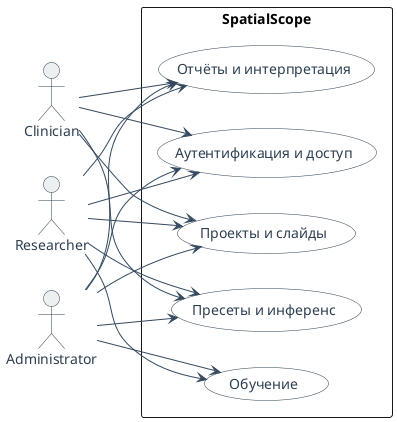

## 2.2. Пользователи и доступ

### Файл
`diploma/docs/uml/use-case-access.puml`

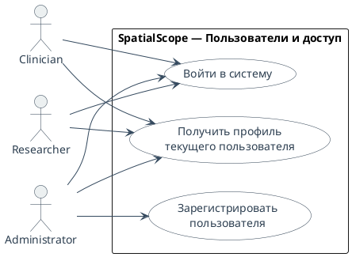

## 2.3. Проекты и слайды

### Файл
`diploma/docs/uml/use-case-projects-slides.puml`

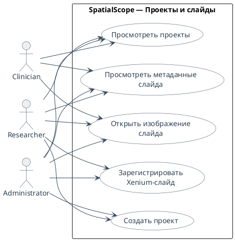

## 2.4. Пресеты и инференс

### Файл
`diploma/docs/uml/use-case-inference.puml`

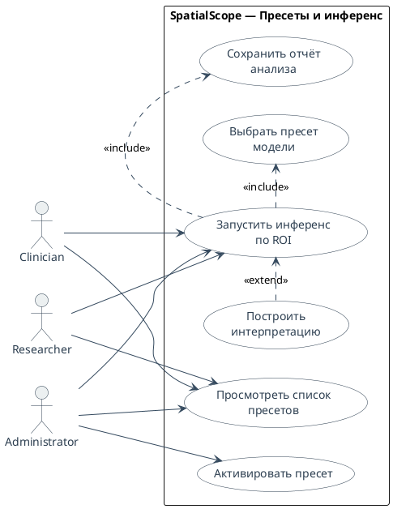

## 2.5. Обучение

### Файл
`diploma/docs/uml/use-case-training.puml`

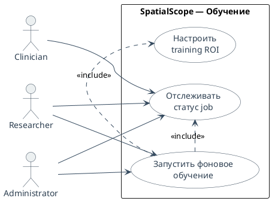

## 2.6. Отчёты и интерпретация

### Файл
`diploma/docs/uml/use-case-reports.puml`

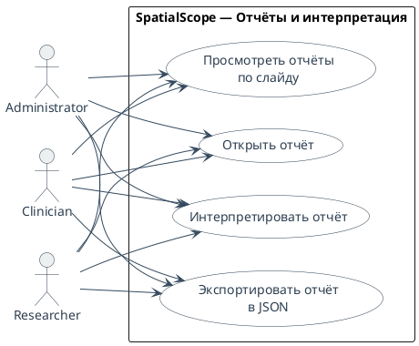

---

# 3. Диаграммы последовательности

## 3.1. Аутентификация

### Файл
`diploma/docs/uml/sequence-login.puml`

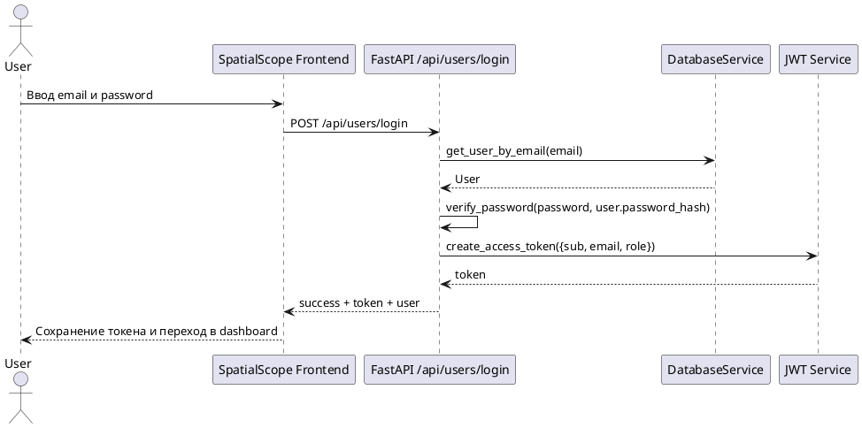

## 3.2. Создание проекта

### Файл
`diploma/docs/uml/sequence-create-project.puml`

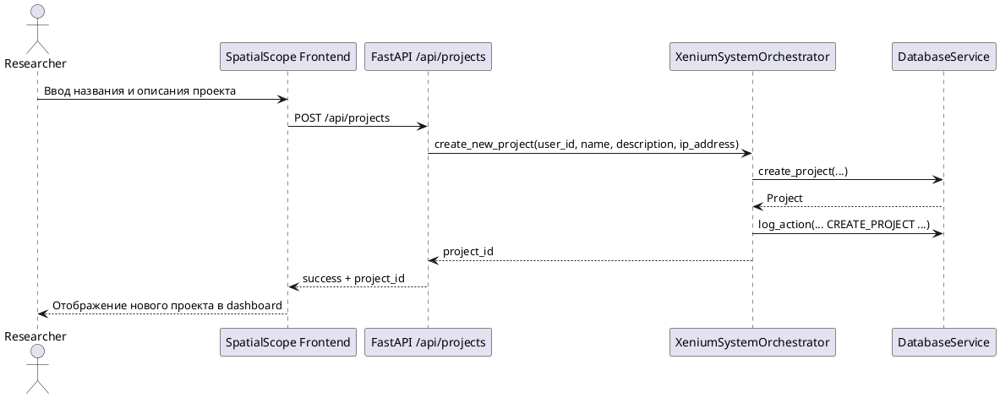

## 3.3. Регистрация слайда

### Файл
`diploma/docs/uml/sequence-register-slide.puml`

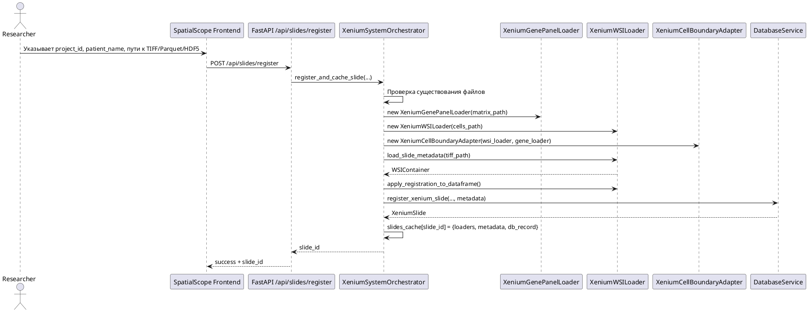

## 3.4. Просмотр слайда

### Файл
`diploma/docs/uml/sequence-view-slide.puml`

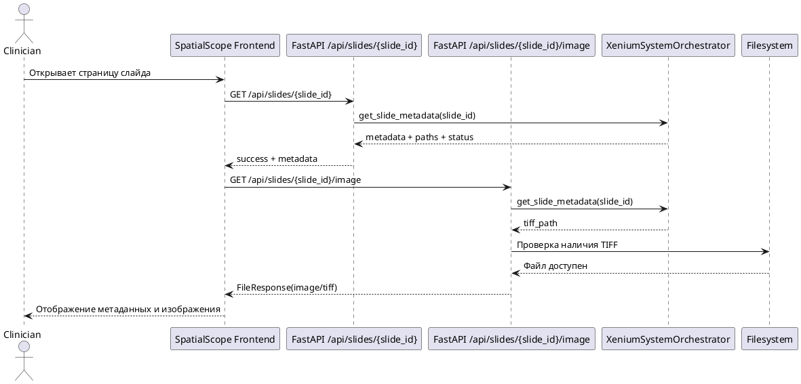

## 3.5. Инференс

### Файл
`diploma/docs/uml/sequence-run-inference.puml`

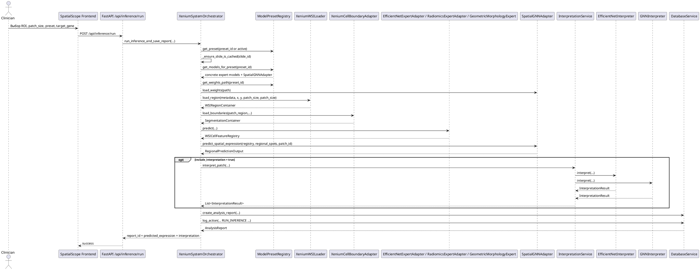

## 3.6. Фоновое обучение

### Файл
`diploma/docs/uml/sequence-start-training.puml`

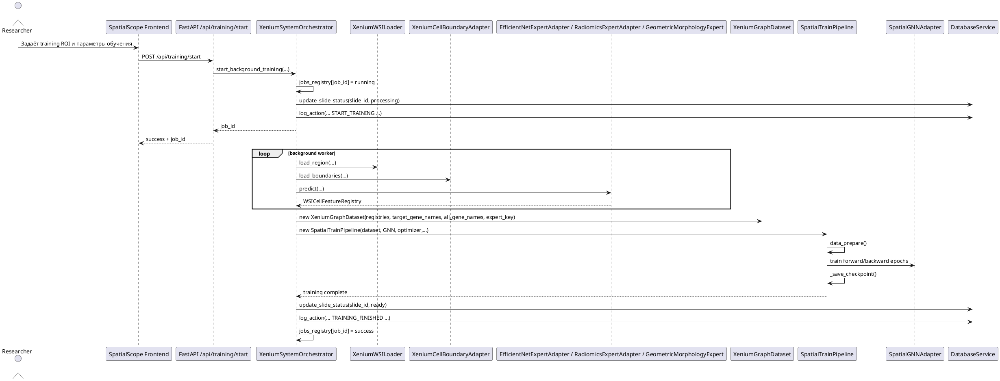

## 3.7. Открытие отчёта

### Файл
`diploma/docs/uml/sequence-open-report.puml`

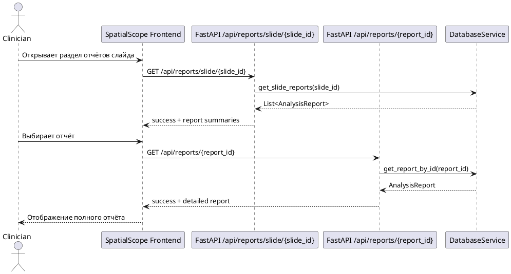

## 3.8. Интерпретация отчёта

### Файл
`diploma/docs/uml/sequence-interpret-report.puml`

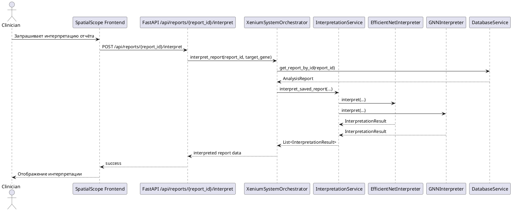

---

# 4. Диаграмма деятельности

## Файл
`diploma/docs/uml/activity-diagram.puml`

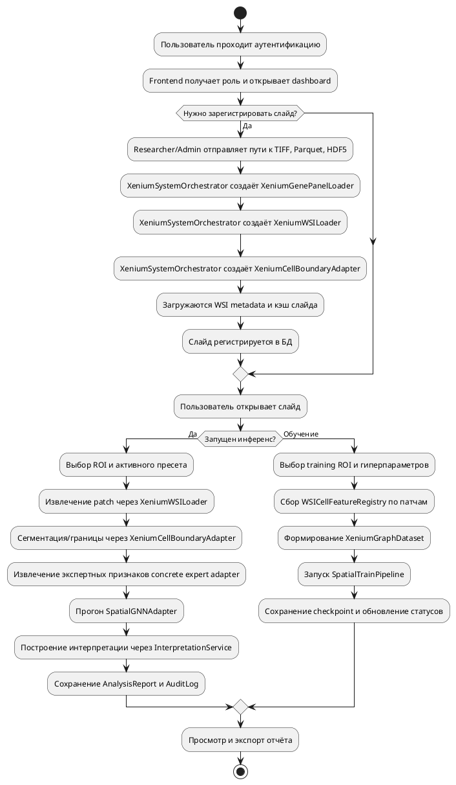

---

# 5. Диаграмма компонентов

## Файл
`diploma/docs/uml/component-diagram.puml`

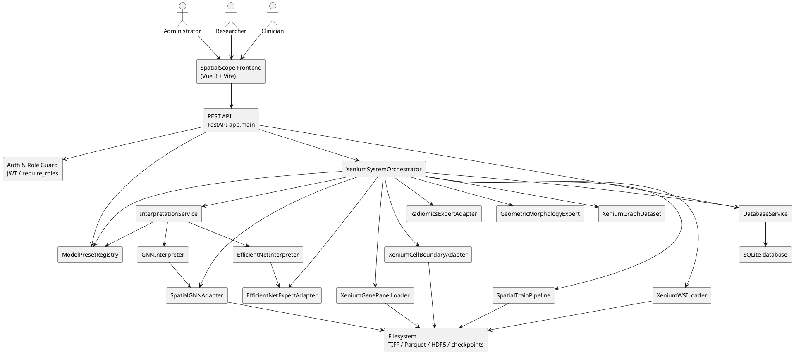

---

# 6. Диаграмма развёртывания

## Файл
`diploma/docs/uml/deployment-diagram.puml`

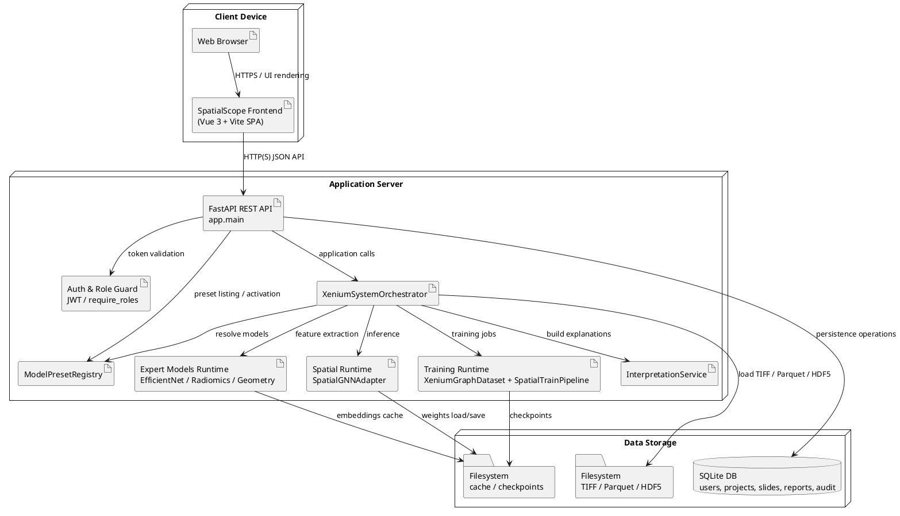

---

# 7. Диаграммы состояний

## 7.1. User

### Файл
`diploma/docs/uml/state/User.puml`

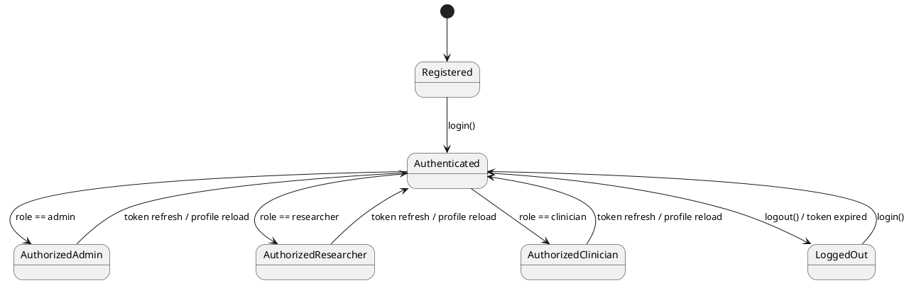

## 7.2. Project

### Файл
`diploma/docs/uml/state/Project.puml`

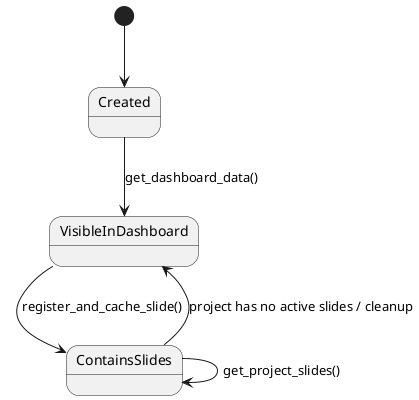

## 7.3. XeniumSlide

### Файл
`diploma/docs/uml/state/XeniumSlide.puml`

```plantuml
@startuml
[*] --> PathsProvided
PathsProvided --> FilesValidated : register_and_cache_slide() / files exist
FilesValidated --> MetadataLoaded : load_slide_metadata()
MetadataLoaded --> Cached : slides_cache[slide_id] initialized
Cached --> Ready : register_xenium_slide(status=ready)
Ready --> InferenceAccessible : get_slide_metadata() / load_region()
InferenceAccessible --> Ready
Ready --> TrainingProcessing : start_background_training()
TrainingProcessing --> Ready : update_slide_status(ready)
TrainingProcessing --> Failed : update_slide_status(failed)
Failed --> TrainingProcessing : retry training
@enduml
```

## 7.4. MLModel

### Файл
`diploma/docs/uml/state/MLModel.puml`

```plantuml
@startuml
[*] --> Declared
Declared --> RegisteredInRegistry : register_expert() / register_spatial_model()
RegisteredInRegistry --> BoundToPreset : create_preset()
BoundToPreset --> LoadedForExecution : get_models_for_preset() / load_weights()
LoadedForExecution --> BoundToPreset : inference or training finished
@enduml
```

## 7.5. ModelPreset

### Файл
`diploma/docs/uml/state/ModelPreset.puml`

```plantuml
@startuml
[*] --> Defined
Defined --> StoredInSystem : create_preset()
StoredInSystem --> AvailableForSelection : get_available_presets()
AvailableForSelection --> Active : set_active_preset()
Active --> UsedForInference : run_inference_and_save_report()
Active --> UsedForTraining : start_background_training()
UsedForInference --> Active
UsedForTraining --> Active
Active --> AvailableForSelection : another preset activated
@enduml
```

## 7.6. AnalysisReport

### Файл
`diploma/docs/uml/state/AnalysisReport.puml`

```plantuml
@startuml
[*] --> PredictionGenerated
PredictionGenerated --> InterpretationAttached : interpret_patch()
InterpretationAttached --> Persisted : create_analysis_report()
Persisted --> Listed : get_slide_reports()
Persisted --> Opened : get_report_by_id()
Opened --> Exported : export_report_json()
Exported --> Opened
Listed --> Opened : select report
@enduml
```

## 7.7. AuditLog

### Файл
`diploma/docs/uml/state/AuditLog.puml`

```plantuml
@startuml
[*] --> EventRaised
EventRaised --> Persisted : log_action()
Persisted --> AvailableForAudit : query / review history
AvailableForAudit --> AvailableForAudit : append next events
@enduml
```

## 7.8. DatabaseService

### Файл
`diploma/docs/uml/state/DatabaseService.puml`

```plantuml
@startuml
[*] --> Idle
Idle --> SessionOpened : _execute()
SessionOpened --> Reading : get_* operation
SessionOpened --> Writing : create_* / update_* / log_action()
Reading --> Committed : success
Writing --> Committed : success
Reading --> RolledBack : exception
Writing --> RolledBack : exception
Committed --> SessionClosed : session.close()
RolledBack --> SessionClosed : session.close()
SessionClosed --> Idle
@enduml
```

## 7.9. XeniumSystemOrchestrator

### Файл
`diploma/docs/uml/state/XeniumSystemOrchestrator.puml`

```plantuml
@startuml
[*] --> Ready
Ready --> SlideRegistration : register_and_cache_slide()
SlideRegistration --> Ready : slide cached and persisted
Ready --> DashboardAggregation : get_dashboard_data()
DashboardAggregation --> Ready
Ready --> InferenceExecution : run_inference_and_save_report()
InferenceExecution --> ReportPersistence : create_analysis_report()
ReportPersistence --> Ready
Ready --> TrainingLaunch : start_background_training()
TrainingLaunch --> JobMonitoring : get_job_status()
JobMonitoring --> Ready : success
JobMonitoring --> FailureHandling : failed
FailureHandling --> Ready : retry / recovery
Ready --> ReportInterpretation : interpret_report()
ReportInterpretation --> Ready
@enduml
```

## 7.10. ModelPresetRegistry

### Файл
`diploma/docs/uml/state/ModelPresetRegistry.puml`

```plantuml
@startuml
[*] --> Empty
Empty --> ExpertsRegistered : register_expert()
ExpertsRegistered --> SpatialModelsRegistered : register_spatial_model()
SpatialModelsRegistered --> PresetsAvailable : create_preset()
PresetsAvailable --> ActivePresetSelected : set_active_preset()
ActivePresetSelected --> RuntimeResolved : get_models_for_preset()
RuntimeResolved --> ActivePresetSelected
ActivePresetSelected --> PresetsEnumerated : get_available_presets()
PresetsEnumerated --> ActivePresetSelected
@enduml
```

## 7.11. PresetConfiguration

### Файл
`diploma/docs/uml/state/PresetConfiguration.puml`

```plantuml
@startuml
[*] --> Defined
Defined --> Validated : create_preset() / IDs resolved in registry
Validated --> Listed : get_available_presets()
Listed --> Selected : set_active_preset()
Selected --> Resolved : get_models_for_preset()
Resolved --> Selected
@enduml
```

## 7.12. InterpretationService

### Файл
`diploma/docs/uml/state/InterpretationService.puml`

```plantuml
@startuml
[*] --> Idle
Idle --> InterpretingPatch : interpret_patch()
InterpretingPatch --> EfficientNetPass : EfficientNet expert present
InterpretingPatch --> GNNPass : spatial model present
EfficientNetPass --> MergeResults
GNNPass --> MergeResults
MergeResults --> Returned
Returned --> Idle
@enduml
```

## 7.13. XeniumWSILoader

### Файл
`diploma/docs/uml/state/XeniumWSILoader.puml`

```plantuml
@startuml
[*] --> ParquetLoaded
ParquetLoaded --> BoundariesLoaded : read boundary parquet
BoundariesLoaded --> CoordinatesNormalized : _normalize_cell_id() / apply_registration_to_dataframe()
CoordinatesNormalized --> MetadataReady : load_slide_metadata()
MetadataReady --> RegionExtractionReady : load_region()
RegionExtractionReady --> CellQueryReady : get_cells_in_region()
CellQueryReady --> RegionExtractionReady
@enduml
```

## 7.14. XeniumGenePanelLoader

### Файл
`diploma/docs/uml/state/XeniumGenePanelLoader.puml`

```plantuml
@startuml
[*] --> MatrixOpened
MatrixOpened --> MatrixIndexed : HDF5 matrix loaded in memory
MatrixIndexed --> GeneNamesAvailable : genes catalog prepared
GeneNamesAvailable --> VectorQueryAvailable : get_gene_vector()
VectorQueryAvailable --> GeneNamesAvailable : repeated queries
@enduml
```

## 7.15. XeniumCellBoundaryAdapter

### Файл
`diploma/docs/uml/state/XeniumCellBoundaryAdapter.puml`

```plantuml
@startuml
[*] --> Ready
Ready --> ManifestExposed : manifest
ManifestExposed --> Ready
Ready --> PatchCellsCollected : load_boundaries() / get_cells_in_region()
PatchCellsCollected --> GeneVectorsAttached : get_gene_vector()
GeneVectorsAttached --> CoordinatesWarpedOrShifted : registration or patch offset applied
CoordinatesWarpedOrShifted --> SegmentationBuilt : SegmentationContainer returned
SegmentationBuilt --> Ready
@enduml
```

## 7.16. EfficientNetExpertAdapter

### Файл
`diploma/docs/uml/state/EfficientNetExpertAdapter.puml`

```plantuml
@startuml
[*] --> Initialized
Initialized --> CacheChecked : predict()
CacheChecked --> LoadedFromCache : cached registry exists
CacheChecked --> PatchPrepared : cache miss
PatchPrepared --> ROIsExtracted : roi_align()
ROIsExtracted --> EmbeddingsComputed : feature_extractor()
EmbeddingsComputed --> RegistryBuilt : WSICellFeatureRegistry
RegistryBuilt --> SavedToCache : pickle.dump()
SavedToCache --> ReadyForReuse
LoadedFromCache --> ReadyForReuse
ReadyForReuse --> CacheChecked : next predict()
@enduml
```

## 7.17. RadiomicsExpertAdapter

### Файл
`diploma/docs/uml/state/RadiomicsExpertAdapter.puml`

```plantuml
@startuml
[*] --> Initialized
Initialized --> CacheChecked : predict()
CacheChecked --> LoadedFromCache : cached registry exists
CacheChecked --> PatchConverted : grayscale / masks prepared
PatchConverted --> RadiomicsComputed : extractor.execute()
RadiomicsComputed --> RegistryBuilt : WSICellFeatureRegistry
RegistryBuilt --> SavedToCache : pickle.dump()
SavedToCache --> ReadyForReuse
LoadedFromCache --> ReadyForReuse
@enduml
```

## 7.18. GeometricMorphologyExpert

### Файл
`diploma/docs/uml/state/GeometricMorphologyExpert.puml`

```plantuml
@startuml
[*] --> Initialized
Initialized --> CacheChecked : predict()
CacheChecked --> LoadedFromCache : cached registry exists
CacheChecked --> NeighborhoodBuilt : KDTree / centroids prepared
NeighborhoodBuilt --> MorphologyComputed : polygons processed
MorphologyComputed --> RegistryBuilt : WSICellFeatureRegistry
RegistryBuilt --> SavedToCache : pickle.dump()
SavedToCache --> ReadyForReuse
LoadedFromCache --> ReadyForReuse
@enduml
```

## 7.19. SpatialGNNAdapter

### Файл
`diploma/docs/uml/state/SpatialGNNAdapter.puml`

```plantuml
@startuml
[*] --> Initialized
Initialized --> WeightsLoaded : load_weights()
Initialized --> GraphReady : _build_graph()
WeightsLoaded --> GraphReady
GraphReady --> InferenceRunning : predict_spatial_expression()
InferenceRunning --> PredictionReturned : RegionalPredictionOutput
PredictionReturned --> GraphReady
GraphReady --> Saved : save_weights()
Saved --> GraphReady
@enduml
```

## 7.20. EfficientNetInterpreter

### Файл
`diploma/docs/uml/state/EfficientNetInterpreter.puml`

```plantuml
@startuml
[*] --> Ready
Ready --> HooksRegistered : interpret()
HooksRegistered --> ForwardExecuted : feature_extractor forward
ForwardExecuted --> BackwardExecuted : score.backward()
BackwardExecuted --> CAMBuilt : GradCAM map computed
CAMBuilt --> ResultBuilt : InterpretationResult
ResultBuilt --> Ready
@enduml
```

## 7.21. GNNInterpreter

### Файл
`diploma/docs/uml/state/GNNInterpreter.puml`

```plantuml
@startuml
[*] --> Ready
Ready --> GraphPrepared : interpret() / _build_graph()
GraphPrepared --> AttentionCollected : conv1(... return_attention_weights=True)
AttentionCollected --> GradientsComputed : backward()
GradientsComputed --> NodeScoresCombined : gradients + attention merged
NodeScoresCombined --> ResultBuilt : InterpretationResult
ResultBuilt --> Ready
@enduml
```

## 7.22. XeniumGraphDataset

### Файл
`diploma/docs/uml/state/XeniumGraphDataset.puml`

```plantuml
@startuml
[*] --> Initialized
Initialized --> PreparingGraphs : _prepare_data()
PreparingGraphs --> GraphSkipped : too few cells / invalid registry
PreparingGraphs --> GraphBuilt : Data(x, edge_index, y)
GraphBuilt --> Stored : append to _precomputed_graphs
GraphSkipped --> PreparingGraphs : next registry
Stored --> Ready : all registries processed
Ready --> Accessed : __getitem__() / __len__()
Accessed --> Ready
@enduml
```

## 7.23. SpatialTrainPipeline

### Файл
`diploma/docs/uml/state/SpatialTrainPipeline.puml`

```plantuml
@startuml
[*] --> Initialized
Initialized --> DataPrepared : data_prepare()
DataPrepared --> TrainingRunning : train()
TrainingRunning --> EpochCompleted : loss computed
EpochCompleted --> CheckpointSaved : _save_checkpoint()
CheckpointSaved --> TrainingRunning : next epoch
EpochCompleted --> BestModelUpdated : loss < best_loss
BestModelUpdated --> TrainingRunning
TrainingRunning --> Finished : all epochs complete
Finished --> BestModelLoaded : load_best_model()
BestModelLoaded --> Finished
@enduml
```

---

## Примечание

Если понадобится, следующий шаг можно сделать таким:

1. собрать ещё и **единый документ с текстовыми описаниями + PlantUML-кодом**;
2. или отдельно сформировать **только state-диаграммы** в самостоятельный отчёт;
3. или подготовить **версию этого файла, оптимизированную для вставки в Word**.
